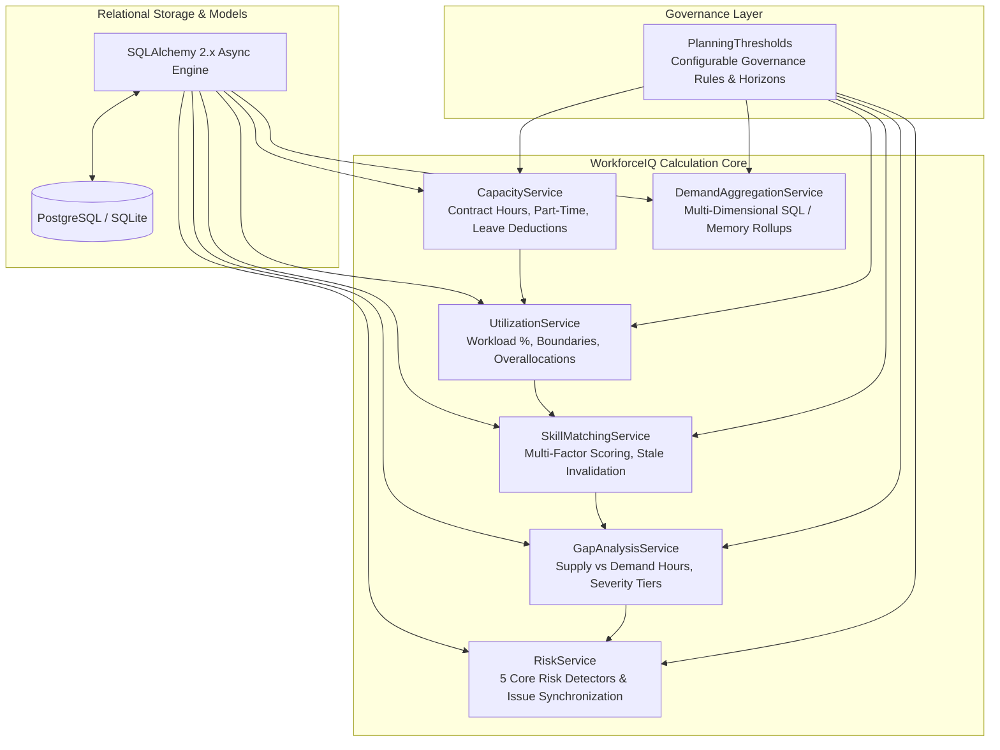
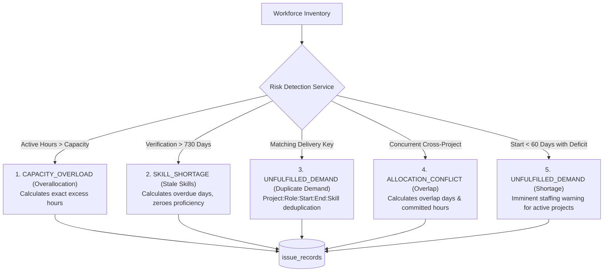

# WorkforceIQ Analytics & Business Calculation Engine

The **WorkforceIQ Analytics Engine** provides a centralized, deterministic, and high-performance calculation infrastructure for enterprise workforce demand forecasting, capacity planning, skill gap intelligence, and operational risk detection.

---

## Architecture & Design Principles

### Core Architecture Rules:
1. **Single Canonical Implementation**: Every business calculation, formula, and metric is implemented once in `app/services/` and shared across API endpoints, batch pipelines, simulation runs, and background tasks. API routes never implement ad-hoc business math.
2. **Configurable Governance**: Hardcoded magic numbers are forbidden. All boundary limits, aging horizons, and risk tiers are governed by the immutable dataclass `PlanningThresholds`.
3. **Model & Serialization Agnostic**: Every calculation engine method accepts both live SQLAlchemy ORM entity models and raw Python dictionaries, enabling in-memory testing and simulations without active database sessions.
4. **Audit Traceability**: Calculations preserve immutable business identifiers, calculation timestamps (`calculated_at`), and rule versions (`rule_version="1.0.0"`).
5. **Batch Processing & SQL Aggregation**: Heavy multi-project rollups leverage SQL group-by aggregations and selectin loading, preventing N+1 query bottlenecks and excessive memory allocation.

---

## 1. Employee Capacity Engine (`CapacityService`)

The capacity calculation establishes an employee's net available working hours within any arbitrary date interval $[t_{\text{start}}, t_{\text{end}}]$.

### Mathematical Formulation:
$$\text{working\_days} = \sum_{d = t_{\text{start}}}^{t_{\text{end}}} \mathbb{I}(\text{weekday}(d) < 5 \land d \ge \text{hire\_date} \land (d \le \text{exit\_date} \lor \text{exit\_date is null}))$$

$$\text{daily\_rate} = \frac{\text{standard\_hours\_per\_week}}{5.0}$$

$$\text{base\_period\_hours} = \text{working\_days} \times \text{daily\_rate}$$

$$\text{leave\_deduction} = \sum_{l \in \text{ApprovedLeave}} \text{overlap\_days}(l) \times \max(0.0, \text{daily\_rate} - \text{available\_hours\_per\_day})$$

$$\text{net\_available\_hours} = \max(0.0, \text{base\_period\_hours} - \text{leave\_deduction})$$

### Lifecycle Status Handling:
- `ACTIVE` / `PROBATION`: Standard capacity based on contract hours.
- `PART_TIME`: Scaled contract hours (e.g., 20.0 or 30.0 hours/week).
- `ON_LEAVE`: Net capacity defaults to 0.0 unless explicit scheduled availability overrides exist.
- `TERMINATED`: Net capacity is strictly 0.0 with `is_active_in_period = False`.

---

## 2. Utilization Engine (`UtilizationService`)

Calculates workload intensity and categorizes employee availability against enterprise thresholds.

### Mathematical Formulation:
$$\text{allocated\_hours} = \sum_{a \in \text{ActiveAllocations}} \left( \frac{\text{overlap\_days}(a, [t_{\text{start}}, t_{\text{end}}])}{7.0} \right) \times \text{allocated\_hours\_per\_week}(a)$$

$$\text{utilization\_pct} = \begin{cases} 
\frac{\text{allocated\_hours}}{\text{net\_available\_hours}} \times 100.0 & \text{if } \text{net\_available\_hours} > 0 \\
999.0 & \text{if } \text{net\_available\_hours} = 0 \land \text{allocated\_hours} > 0 \\
0.0 & \text{if } \text{net\_available\_hours} = 0 \land \text{allocated\_hours} = 0
\end{cases}$$

### Governance Categorization:
| Utilization Range | Classification | Operational Meaning |
| :--- | :--- | :--- |
| $\text{utilization} < 70\%$ | `UNDERUTILIZED` | Excess bench capacity; available for reallocation or new project demands. |
| $70\% \le \text{utilization} < 90\%$ | `NORMAL` | Optimal target capacity; healthy balance of delivery and learning. |
| $90\% \le \text{utilization} \le 100\%$ | `HIGH` | Near full commitment; monitored for potential burn-out. |
| $\text{utilization} > 100\%$ | `OVERALLOCATED` | Deficit capacity; requires immediate manager reallocation or de-scoping. |
| $\text{net\_available} = 0 \land \text{allocated} = 0$ | `ZERO_CAPACITY` | Employee inactive, terminated, or on full-time approved sabbatical/PTO. |

---

## 3. Skill Matching & Verification Invalidation (`SkillMatchingService`)

Ranks available talent against open demand requirements using a composite multi-factor qualification score.

### Critical Business Rule: Stale Skill Invalidation
> **Rule**: An employee skill record whose last verification date exceeds the governance threshold ($730\text{ days} = 2\text{ years}$) **must not count as verified current**.
> 
> When $\text{elapsed\_days} > 730$:
> $$\text{is\_stale} = \text{True}$$
> $$\text{effective\_certified\_proficiency} = 0$$
> $$\text{is\_fully\_qualified} = \text{False}$$

### Multi-Factor Scoring Formula (0 to 100%):
$$\text{MatchScore} = 100.0 \times \left( 0.45 \cdot S_{\text{proficiency}} + 0.35 \cdot S_{\text{availability}} + 0.15 \cdot S_{\text{role}} + 0.05 \cdot S_{\text{verification}} \right)$$

1. **Proficiency Fit ($45\%$)**:
   $$S_{\text{proficiency}} = \min\left(1.0, \frac{\text{effective\_certified\_proficiency}}{\text{required\_proficiency}}\right)$$
2. **Availability Fit ($35\%$)**:
   $$S_{\text{availability}} = \min\left(1.0, \frac{\max(0.0, \text{remaining\_capacity\_hours})}{\text{required\_hours}}\right)$$
3. **Role Alignment ($15\%$)**:
   $$S_{\text{role}} = \begin{cases} 1.0 & \text{if role exactly matches demanded role} \\ 0.85 & \text{if role unspecified} \\ 0.75 & \text{if cross-functional role} \end{cases}$$
4. **Verification Confidence ($5\%$)**:
   $$S_{\text{verification}} = \begin{cases} 
   0.0 & \text{if is\_stale is True} \\
   1.0 & \text{ASSESSMENT\_CERTIFIED} \\
   0.85 & \text{MANAGER\_VERIFIED} \\
   0.50 & \text{SELF\_REPORTED} \\
   0.20 & \text{UNVERIFIED}
   \end{cases}$$

---

## 4. Multi-Dimensional Demand Aggregation (`DemandAggregationService`)

Provides fast aggregations across core workforce planning dimensions:
- **Project**: Aggregates committed requirements, headcount, and total demand hours per initiative.
- **Role**: Groups capacity needs by job family and organizational hierarchy.
- **Skill**: Identifies technology and domain volume demands across the enterprise.
- **Priority**: Separates mission-critical demand (Priority 1) from backlog and pipeline demands.

Both in-memory methods (`aggregate_records`) and SQL group-by queries (`aggregate_by_project_async`, `aggregate_by_role_async`, `aggregate_by_skill_async`, `aggregate_by_priority_async`) are provided.

---

## 5. Talent Gap Analysis Engine (`GapAnalysisService`)

Quantifies deficits between project demand requirements and qualified internal talent supply.

### Calculated Metrics:
- **Headcount Deficit**:
  $$\text{headcount\_deficit} = \max(0, \text{required\_headcount} - \text{available\_qualified\_headcount})$$
- **Unfilled Demand Hours**:
  $$\text{unfilled\_hours} = \max(0.0, \text{required\_hours} - \text{fulfilled\_hours})$$
- **Capacity Gap Hours**:
  $$\text{capacity\_gap} = \max(0.0, \text{required\_hours} - \text{qualified\_supply\_hours})$$

### Dynamic Severity Assignment:
$$\text{Severity} = \begin{cases}
\text{CRITICAL} & \text{if Priority } \le 1 \lor \text{unfilled\_pct} \ge 60\% \\
\text{HIGH} & \text{if } \text{unfilled\_pct} \ge 40\% \lor \text{headcount\_deficit} \ge 3 \\
\text{MEDIUM} & \text{if } \text{unfilled\_pct} \ge 20\% \\
\text{LOW} & \text{otherwise}
\end{cases}$$

---

## 6. Operational Workforce Risk Detection (`RiskService`)

The Risk Detection Service scans workforce schedules and demand inventories to identify 5 core risk categories and persists actionable records to `issue_records`.

### Risk Detection Matrix:
| Risk Type | Target Entity | Issue Classification | Default Severity | Action Required |
| :--- | :--- | :--- | :--- | :--- |
| **Overallocation** | `Allocation` | `CAPACITY_OVERLOAD` | `CRITICAL` | `REDUCE_ALLOCATION_HOURS` |
| **Stale Skills** | `EmployeeSkill` | `SKILL_SHORTAGE` | `HIGH` | `REVERIFY_EMPLOYEE_SKILL` |
| **Duplicate Demand** | `DemandPlan` | `UNFULFILLED_DEMAND` | `MEDIUM` | `DE_DUPLICATE_DEMAND_LINE` |
| **Overlapping Allocations** | `Allocation` | `ALLOCATION_CONFLICT` | `HIGH` | `RESOLVE_SCHEDULE_OVERLAP` |
| **Staffing Shortage** | `DemandPlan` / `Project` | `UNFULFILLED_DEMAND` | `CRITICAL` / `HIGH` | `ALLOCATE_RESOURCES_OR_HIRE` |

---

## Test Verification Summary

The complete test suite runs under `pytest` with HTTPX and AsyncClient:
- **Total Tests**: 40 passed
- **Analytics Tests**: 15 passed in `backend/tests/test_analytics.py`
  - Normal full-time capacity calculation
  - Part-time capacity (20h and 30h)
  - Leave deductions (PTO, sick leave, partial days)
  - Zero available capacity (terminated employees and full-week PTO)
  - Utilization categorization boundaries (50%, 80%, 95%, 125%)
  - Zero-capacity boundary handling
  - Stale skill invalidation (>730 days discounts certified proficiency to 0)
  - Multi-dimensional demand aggregation (Project, Role, Skill, Priority)
  - Gap analysis quantitative calculations and severity assignments
  - Overallocation detection with exact excess hours
  - Stale skill detection with overdue days calculation
  - Duplicate demand detection with delivery identity preservation
  - Overlapping allocations across distinct projects
  - Imminent project staffing shortage detection (<60 days)
  - Configurable `PlanningThresholds` runtime overrides

