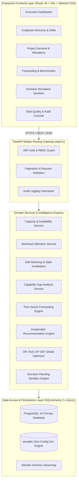
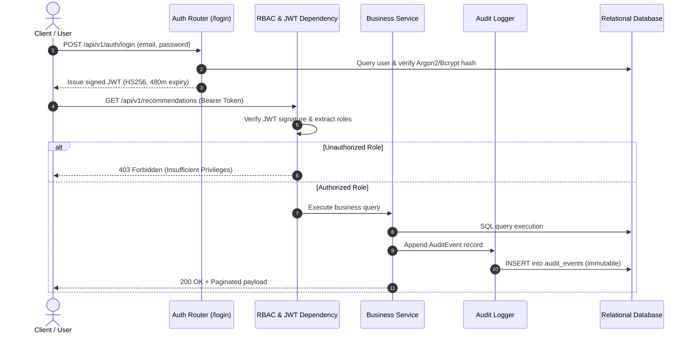

# WorkforceIQ – System Architecture & Engineering Specification

## 1. Executive Architectural Overview

**WorkforceIQ** is an enterprise-grade AI-powered workforce demand forecasting, capacity planning, and skill gap intelligence platform. It provides quantitative analytics and explainable recommendations to remediate enterprise talent deficits, prevent burnout caused by overallocation, and optimize project assignments across complex global organizations.

The system is architected around **Clean Architecture / Hexagonal Principles**, strictly decoupling business calculation engines and mathematical programming solvers from persistence layers, presentation frameworks, and external services.

---

## 2. Layered Architectural Decomposition

### 2.1 Presentation Layer (`frontend/src/`)
- **Technology**: React 18, Vite 5, Tailwind CSS, shadcn/ui component primitives, Lucide React icons, Recharts visualization library.
- **State Management & Routing**: React Router v6 with declarative protected route wrappers (`ProtectedRoute.jsx`), contextual user session provider (`AuthContext.jsx`), Axios HTTP client with request interceptors injecting JWT bearer tokens and response interceptors handling token invalidation and refresh gracefully.
- **Design Language**: Enterprise SaaS design with deep navy sidebar (`#0f172a`), clean slate content surfaces (`#f8fafc`), crisp data tables, interactive forecasting charts, and visual risk indicators (red for critical overallocation, amber for stale skills/warning, emerald for optimal utilization).

### 2.2 API Gateway & Controller Layer (`backend/app/api/`)
- **Technology**: FastAPI 0.110+ on Uvicorn ASGI server.
- **Domain Routers**: 16 dedicated REST namespaces mounted under `/api/v1`:
  - `auth`, `employees`, `roles`, `skills`, `projects`, `demand`, `allocations`, `availability`, `training`, `analytics`, `forecasting`, `recommendations`, `scenarios`, `risks`, `quality`, `evaluation`, and `audit`.
- **Cross-Cutting Concerns**:
  - Request validation through strict Pydantic v2 schemas.
  - Role-Based Access Control (`require_roles` dependency) enforcing permissions across 5 enterprise roles: `ADMIN`, `HR_PARTNER`, `PROJECT_MANAGER`, `OPERATIONS_PARTNER`, `EMPLOYEE`.
  - Immutable audit logging interceptors recording all create, update, delete, and reallocation events into `audit_events`.

### 2.3 Domain Services Layer (`backend/app/services/`)
- Pure business logic implemented as stateless Python services supporting dual operational modes (ORM entity models or serialized dictionaries).
- Guarantees zero SQL coupling inside calculation algorithms:
  - `capacity_service.py`: Computes working calendar days, contractual hours, and exact PTO deductions.
  - `utilization_service.py`: Classifies utilization percentages across standard brackets (`UNDERUTILIZED`, `NORMAL`, `HIGH`, `OVERALLOCATED`).
  - `skill_matching_service.py`: Computes 0-100 match scores while strictly invalidating stale skill verifications (>730 days).
  - `gap_analysis_service.py`: Identifies capacity deficits and classifies severity (`LOW`, `MEDIUM`, `HIGH`, `CRITICAL`).
  - `forecasting/`: Houses baseline models (Seasonal Naive, Moving Average, Exponential Smoothing) and Autoregressive Random Forest with walk-forward time splits.
  - `recommendation/`: Hierarchical explainable engine evaluating Reallocate -> Train -> Hire -> Reschedule.
  - `optimization/`: Formulates and executes global integer programming via Google OR-Tools CP-SAT.
  - `scenario_service.py`: Sandbox engine simulating organizational interventions without modifying baseline data.

### 2.4 Data Access & Persistence Layer (`backend/app/models/`, `backend/app/database.py`)
- **ORM**: SQLAlchemy 2.0 with asynchronous I/O (`AsyncSession`, `select`, `where`).
- **Resilient Dual-Engine Architecture**:
  1. Primary: PostgreSQL 16 via `asyncpg` connection pool with automatic health check probes.
  2. Fallback: If PostgreSQL is unreachable during local development, an automated fallback transparently activates an embedded `aiosqlite` SQLite engine at `workforce_iq_dev.db`.
- **Schema Management**: Alembic migration scripts supporting zero-downtime forward migrations.

---

## 3. Mathematical Optimization Formulation (Google OR-Tools CP-SAT)

Workforce allocation is formulated as a **Mixed-Integer Linear Constraint Programming Problem** solved via Google OR-Tools CP-SAT:

### 3.1 Indices and Sets
- $d \in D$: Unfulfilled project demand items requiring staffing.
- $e \in E$: Available employees in the organization.
- $p \in P$: Active enterprise projects.
- $s \in S$: Specific skills required by demand items.

### 3.2 Decision Variables
- $x_{d,e} \in \{0, 1\}$: Binary variable equal to 1 if employee $e$ is allocated to demand item $d$, 0 otherwise.
- $y_d \in \{0, 1\}$: Binary variable equal to 1 if demand item $d$ remains unfilled (shortage penalty), 0 otherwise.
- $t_{d,e} \in \{0, 1\}$: Binary variable equal to 1 if employee $e$ is assigned to demand $d$ via an accelerated upskilling/training pathway.

### 3.3 Objective Function
Minimize total weighted operational deficit:
$$\min Z = \sum_{d \in D} \sum_{e \in E} C_{e} \cdot H_d \cdot x_{d,e} + \sum_{d \in D} W_d \cdot P_d \cdot y_d + \sum_{d \in D} \sum_{e \in E} (T_{\text{cost}} + M_{d,e}) \cdot t_{d,e}$$

Where:
- $C_e$: Hourly billing/cost rate of employee $e$.
- $H_d$: Required allocation hours for demand item $d$.
- $W_d$: Project priority weighting factor ($W_1 = 1000, W_2 = 500, W_3 = 200$).
- $P_d$: Shortage penalty per unfilled demand hour.
- $T_{\text{cost}}$: Training investment cost.
- $M_{d,e}$: Skill mismatch penalty ($M = 100 \times (\text{RequiredProficiency} - \text{CurrentProficiency})$).

### 3.4 Operational Constraints
1. **Demand Assignment Exclusivity**:
   $$\sum_{e \in E} x_{d,e} + y_d = 1 \quad \forall d \in D$$
   *Each demand item must be either fulfilled by an internal employee or flagged as unfilled.*

2. **Employee Available Capacity Bound (Zero Double-Counting)**:
   $$\sum_{d \in D} H_d \cdot x_{d,e} \le \text{AvailableHours}_e \quad \forall e \in E$$
   *An employee cannot be allocated beyond their net available working hours within the period.*

3. **Stale Skill Exclusion Constraint**:
   $$x_{d,e} = 0 \quad \forall (d,e) \text{ where } \text{VerificationAge}(e, s_d) > 730 \text{ days}$$
   *Employees with expired or stale skill certifications cannot be directly assigned without upskilling.*

4. **Lifecycle Status Eligibility**:
   $$x_{d,e} = 0 \quad \forall e \text{ where } \text{Status}_e \ne \text{ACTIVE}$$
   *Only active employees are eligible for project allocation.*

---

## 4. Security, Compliance & Governance Architecture

### 4.1 Authentication & Authorization
- **Token Format**: Standard RFC 7519 JWT signed with HMAC-SHA256.
- **Payload Claims**: `sub` (employee ID), `email`, `role`, `iat`, `exp` (default 480 minutes / 8 hours).
- **Revocation**: Server-side in-memory blacklist rejecting revoked bearer tokens prior to expiration.
- **Enterprise Personas**:
  - `ADMIN`: Full access to configuration, data generation, and audit logs.
  - `OPERATIONS_PARTNER`: Global scenario planning, risk scans, and allocation management.
  - `PROJECT_MANAGER`: Demand planning, project allocation, and recommendation reviews.
  - `HR_PARTNER`: Employee directories, skills matrix, and training enrollment.
  - `EMPLOYEE`: Self-service profile, availability submission, and enrolled training views.

### 4.2 Auditability & Compliance Trail
- Every write mutation (allocation creation, reallocation, recommendation status transition, scenario execution) generates an append-only `AuditEvent` record.
- Captures: `business_id` (`AUD-2026-XXXXXX`), `entity_type`, `entity_id`, `action` (`INSERT`, `UPDATE`, `ALLOCATE`, `SIMULATE`), `performed_by_id`, JSON snapshots of `old_values` and `new_values`, client IP address, and UTC timestamp.

