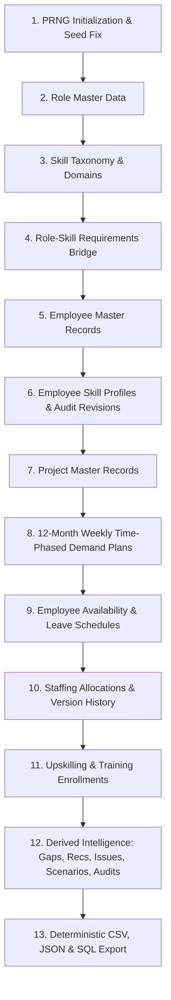

# WorkforceIQ – Synthetic Data Generation Pipeline Documentation

## 1. Architectural Overview

The **WorkforceIQ Synthetic Data Generation Pipeline** is an enterprise-grade, deterministic data generation engine designed to create realistic workforce simulation benchmarks, project capacity scenarios, and skill gap telemetry.

The engine guarantees:
1. **Mathematical Determinism**: With a fixed seed (`20261022`), running the pipeline produces byte-for-byte identical datasets across Python's `random`, NumPy's `Generator`, and `Faker`.
2. **Relational & Referential Integrity**: Generates 15 relational tables in strict topological order, guaranteeing that every foreign key resolves to a valid, generated parent primary key.
3. **Enterprise Privacy & Provenance**: Zero real employee or proprietary client information is used. All email addresses use the synthetic domain `@workforceiq.synthetic`, and all exports include a cryptographic SHA256 manifest.
4. **Canonical Business Identifiers**: Adheres to strict enterprise identifier formats (e.g., `EMP-000001`, `SKL-000001`, `PRJ-2026-000001`) with deterministic UUIDv5 primary keys.

---

## 2. Pipeline Execution Order (12 Chronological Steps)

The generator executes in strict dependency order:



1. **PRNG Initialization**: Initializes `random.seed(seed)`, `np.random.default_rng(seed)`, and `Faker.seed(seed)`.
2. **Role Master Data**: 40 distinct enterprise roles across Cloud & Platform, Data & AI, Cybersecurity, Architecture, and Software Engineering.
3. **Skill Taxonomy**: 300 skills spanning Technical, Domain, Leadership, Methodology, Tool, and Compliance categories.
4. **Role-Skill Competency Mapping**: Maps roles to required mandatory and optional skills with proficiency benchmarks (levels 1–5).
5. **Employee Master Records**: Generates workforce records with realistic department mappings, experience tiers (Junior, Mid-Level, Senior, Lead/Principal), tenure-based hire dates, and hourly cost rates.
6. **Employee Skill Profiles**: Assigns 6–10 skills per employee with proficiency ratings (1–5) and historical verification audit tracking (`SELF_REPORTED`, `MANAGER_VERIFIED`, `ASSESSMENT_CERTIFIED`).
7. **Project Master Records**: Projects with strategic themes, active start/end windows, budgets ($250k–$2.5M), and assigned senior managers.
8. **12 Months Weekly Demand Plans**: 52 weeks of time-phased staffing demand with quarterly seasonal variation multipliers (Q1: 1.15, Q2: 1.05, Q3: 0.85, Q4: 1.20).
9. **Availability & Leave**: Base 40h/week (or 20h/30h part-time), corporate holiday shutdowns, summer PTO blocks, and sick leave.
10. **Staffing Allocations**: Matches employees to project demand, modeling single and multi-project assignments (40%, 50%, 60%, 100% utilization), preserving allocation history (v1 superseded by v2).
11. **Training & Upskilling**: Targeted course enrollments with external providers (Coursera, AWS Training, O'Reilly), costs, and scheduled completion dates.
12. **Derived Intelligence & Telemetry**:
    - **GapAnalysis**: Computes headcount deficits between demand and active allocations.
    - **Recommendation**: Generates AI-assisted mitigation strategies (`INTERNAL_REALLOCATION`, `TRAINING_UPSKILL`, `EXTERNAL_HIRE`, `CONTRACTOR_CONTINGENT`).
    - **IssueRecord**: Flags staffing risks (e.g., overcapacity utilization >100%).
    - **ScenarioRun**: Baseline simulation telemetry.
    - **AuditEvent**: Cryptographic audit trace for the generated dataset.

---

## 3. Scale Configurations

| Metric / Parameter | Starter Scale | Full Scale | Purpose / Target |
| :--- | :--- | :--- | :--- |
| **Employees** | 100 | 5,000 | Baseline organizational workforce |
| **Skills Catalog** | 30 | 300 | Enterprise skill ontology |
| **Projects** | 20 | 500 | Multi-department project portfolio |
| **Job Roles** | 15 | 40 | Enterprise job architecture |
| **Time Horizon** | 12 months (52 weeks) | 12 months (52 weeks) | Time-phased planning horizon (CY2026) |
| **Total Rows Generated** | **3,354 rows** | **113,000+ rows** | Complete normalized schema coverage |
| **Execution Time** | **~1.1 seconds** | **~45 seconds** | Rapid generation and verification |

---

## 4. Canonical Identifier Format Reference

| Entity | Business ID Format | Example Business ID | Primary Key Pattern |
| :--- | :--- | :--- | :--- |
| **Role** | `ROL-######` | `ROL-000001` | Deterministic UUIDv5 |
| **Skill** | `SKL-######` | `SKL-000001` | Deterministic UUIDv5 |
| **RoleSkill** | `ROLSKL-######` | `ROLSKL-000001` | Deterministic UUIDv5 |
| **Employee** | `EMP-######` | `EMP-000001` | Deterministic UUIDv5 |
| **EmployeeSkill** | `EMPSKL-######` | `EMPSKL-000001` | Deterministic UUIDv5 |
| **Project** | `PRJ-YYYY-######` | `PRJ-2026-000001` | Deterministic UUIDv5 |
| **DemandPlan** | `DEM-<project-id>-YYYYWww-R#` | `DEM-PRJ-2026-000001-2026W01-R1` | Deterministic UUIDv5 |
| **Availability** | `AVL-YYYY-######` | `AVL-2026-000001` | Deterministic UUIDv5 |
| **Allocation** | `ALLOC-YYYY-######` | `ALLOC-2026-000001` | Deterministic UUIDv5 |
| **Training** | `TRN-YYYY-######` | `TRN-2026-000001` | Deterministic UUIDv5 |
| **GapAnalysis** | `GAP-YYYY-######` | `GAP-2026-000001` | Deterministic UUIDv5 |
| **Recommendation**| `REC-YYYY-######` | `REC-2026-000001` | Deterministic UUIDv5 |
| **IssueRecord** | `ISS-YYYY-######` | `ISS-2026-000001` | Deterministic UUIDv5 |
| **ScenarioRun** | `SCN-YYYY-######` | `SCN-2026-000001` | Deterministic UUIDv5 |
| **AuditEvent** | `AUD-YYYY-######` | `AUD-2026-000001` | Deterministic UUIDv5 |

---

## 5. Realism & Business Rules Enforced

1. **Skill Proficiency Scale (1–5)**:
   - Level 1: Novice / Fundamental Awareness
   - Level 2: Intermediate / Working Knowledge
   - Level 3: Competent / Practitioner
   - Level 4: Advanced / Subject Matter Expert
   - Level 5: Master / Industry Thought Leader
2. **Employment Distribution**:
   - `ACTIVE`: 85%
   - `CONTRACTOR`: 8%
   - `ON_LEAVE`: 4%
   - `PROBATION`: 3%
3. **Capacity & Utilization**:
   - Full-time employees: 40.0 hours/week (88%)
   - Part-time employees: 30.0 hours/week (7%) and 20.0 hours/week (5%)
   - Allocations model dedicated projects (100%), split projects (50%), and overcapacity risks (60% + 50% = 110%).
4. **Historical Versioning & Audit Preservation**:
   - Revisions do not overwrite prior allocations; ~15% of allocations maintain an archived Version 1 record with `is_active=False` and a `superseded_by_id` pointer to Version 2.
   - Skill profiles preserve prior expired certifications for senior staff to document historical career progression.
5. **Seasonal Demand Variation**:
   - Q1: $1.15\times$ (Budget kickoff and new project starts)
   - Q2: $1.05\times$ (Steady execution)
   - Q3: $0.85\times$ (Summer slowdown)
   - Q4: $1.20\times$ (Year-end milestone delivery push)

---

## 6. CLI Commands & Usage

### Starter Scale Generation (Quick Simulation)
```powershell
$env:PYTHONPATH='backend'; backend\venv\Scripts\python.exe -m backend.generator.generate --scale starter --seed 20261022
```

### Full Scale Generation (5,000 Employees, 500 Projects, 300 Skills)
```powershell
$env:PYTHONPATH='backend'; backend\venv\Scripts\python.exe -m backend.generator.generate --scale full --seed 20261022
```

### Optional CLI Arguments
- `--scale`: `starter` (default) or `full`.
- `--seed`: Integer PRNG seed (default: `20261022`).
- `--as-of-date`: Reference simulation date (default: `2026-10-22`).
- `--output-dir`: Export target directory (default: `data/exports`).
- `--format`: Export formats `all` (default), `csv`, `json`, or `sql`.
- `--seed-db`: Flag to directly populate the active PostgreSQL or SQLite database.

---

## 7. Export Structure & Provenance Manifest

Every generation run produces an export directory under `data/exports/<scale>/`:

```
data/exports/
├── starter/
│   ├── csv/                   # 15 normalized CSV tables (deterministic row order)
│   ├── json/                  # 15 individual JSON tables + workforce_dataset.json
│   ├── sql/
│   │   └── seed_data.sql      # PostgreSQL/SQLite compatible multi-row INSERTs
│   └── manifest.json          # Metadata, row counts, and SHA256 checksums
└── full/
    ├── csv/
    ├── json/
    ├── sql/
    │   └── seed_data.sql
    └── manifest.json
```

### Manifest Integrity Verification
The generated `manifest.json` documents data provenance:
- Generator version (`1.0.0`).
- Synthetic provenance disclaimer.
- Complete execution time and timestamp.
- Exact table-by-table row counts.
- Cryptographic SHA256 hashes of every exported artifact.

