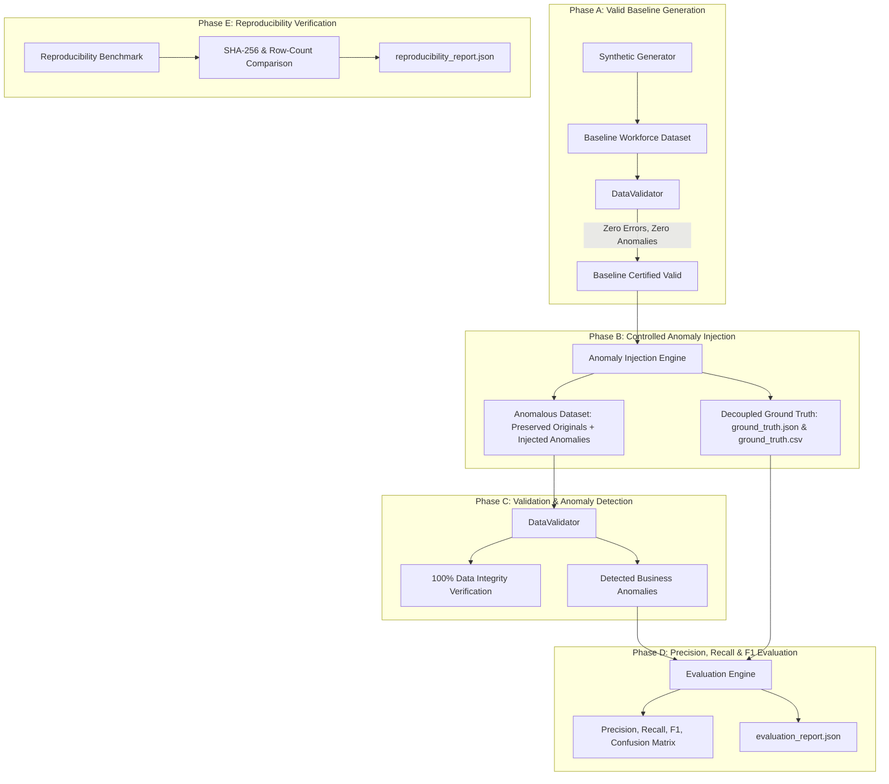

# WorkforceIQ – Data Quality, Anomaly Injection & Evaluation Engine

## 1. Architectural Overview

The **WorkforceIQ Data Quality & Evaluation Subsystem** provides enterprise-grade data validation, deliberate controlled anomaly injection, decoupled ground-truth benchmarking, and cryptographic reproducibility testing.



---

## 2. Four Mandatory Anomaly Implementations

Controlled anomalies are injected **only after the baseline dataset passes 100% of relational and business validation checks**. Original baseline records are preserved.

### 1. OVERALLOCATION
* **Definition**: An active staffing allocation that causes an employee's total concurrent allocated hours to breach their standard weekly capacity.
* **Preservation**: Original active bookings remain untouched; an incremental allocation is added.
* **Exact Calculation**:
  $$\text{Total Hours} = \text{Base Hours} + \text{Injected Hours}$$
  $$\text{Exact Excess Hours} = \text{Total Hours} - \text{Weekly Capacity Hours}$$
* **Ground Truth Action**: `REDUCE_ALLOCATION_HOURS` (Severity: `CRITICAL`).

### 2. STALE_SKILL
* **Definition**: An employee skill competency whose verification timestamp is older than the allowed enterprise validity threshold (730 days / 2 years) while remaining marked as active and current.
* **Preservation**: `is_current = True` is preserved without silently modifying historical audit trails.
* **Exact Calculation**:
  $$\text{Elapsed Days} = \text{as\_of\_date} - \text{verified\_date}$$
  $$\text{Days Overdue} = \text{Elapsed Days} - 730$$
* **Ground Truth Action**: `REVERIFY_EMPLOYEE_SKILL` (Severity: `HIGH`).

### 3. DUPLICATE_DEMAND
* **Definition**: A second delivery of an existing demand requirement sharing identical project, role, time interval, and primary skill.
* **Preservation**: Retains both source records; assigns unique primary keys and a distinct duplicate business identifier.
* **Deduplication Identity**:
  $$\text{Delivery Identity} = \text{project\_id} : \text{role\_id} : \text{start\_date} : \text{end\_date}$$
  Legitimate separate demand components (different roles or timeframes in the same project) are strictly protected from false deduplication.
* **Ground Truth Action**: `DE_DUPLICATE_DEMAND_LINE` (Severity: `MEDIUM`).

### 4. OVERLAPPING_ALLOCATION
* **Definition**: Assigns one employee to concurrent, overlapping project time intervals on multiple distinct projects.
* **Preservation**: Retains both project assignments intact in the database.
* **Exact Calculation**:
  $$\text{Overlap Start} = \max(T_{1,\text{start}}, T_{2,\text{start}})$$
  $$\text{Overlap End} = \min(T_{1,\text{end}}, T_{2,\text{end}})$$
  $$\text{Overlap Days} = (\text{Overlap End} - \text{Overlap Start}) + 1$$
  $$\text{Overlap Hours} = \left(\frac{\text{Overlap Days}}{7}\right) \times \text{Weekly Committed Hours}$$
* **Ground Truth Action**: `RESOLVE_SCHEDULE_OVERLAP` (Severity: `HIGH`).

---

## 3. Decoupled Ground Truth Architecture

To prevent **label leakage**, ground truth is never embedded into operational input data or database tables. It is stored independently in two formats:

1. `data/evaluation/ground_truth.json`
2. `data/evaluation/ground_truth.csv`

### Ground Truth Schema

| Field Name | Type | Description | Example |
| :--- | :--- | :--- | :--- |
| `scenario_id` | `string` | Unique scenario benchmark identifier | `SCN-ANOMALY-OVERALLOC-0001` |
| `entity_type` | `string` | Target entity model | `Allocation`, `EmployeeSkill`, `DemandPlan` |
| `entity_id` | `string` | Primary key UUID of the anomalous entity | `74697673-39f6-568a-a1d9-bb99038a1145` |
| `issue_type` | `string` | Canonical anomaly classification | `OVERALLOCATION`, `STALE_SKILL`, etc. |
| `expected_detection` | `boolean`| Whether detection is anticipated | `true` |
| `expected_severity` | `string` | Anomaly risk severity | `CRITICAL`, `HIGH`, `MEDIUM`, `LOW` |
| `expected_action` | `string` | Recommended mitigation action | `REDUCE_ALLOCATION_HOURS` |
| `expected_value` | `object/json`| Exact quantitative measurements | `{"excess_hours": 23.18, "capacity": 40.0}` |
| `rule_version` | `string` | Validation rule specification version | `1.0.0` |

---

## 4. Separation of Integrity Failures vs. Business Anomalies

The validation engine strictly differentiates technical schema failures from business-rule anomalies:

1. **Data Integrity Failures** (Schema Corruption):
   - Non-unique Primary Keys
   - Broken Foreign Key references
   - Missing required non-nullable fields
   - Invalid enumeration values
   - Inverted date ordering ($T_{\text{start}} > T_{\text{end}}$)
   *Target: 0 failures on all datasets.*

2. **Business Anomalies** (Domain Intelligence Violations):
   - Capacity breaches (`OVERALLOCATION`)
   - Skill recertification expirations (`STALE_SKILL`)
   - Replicated requirement deliveries (`DUPLICATE_DEMAND`)
   - Conflicting cross-project schedules (`OVERLAPPING_ALLOCATION`)
   *Target: Correctly flagged with quantitative severity and remediation action.*

---

## 5. Benchmark Performance Results

Execution on the baseline dataset with deliberate anomaly injection produces:

```
=======================================================
 EVALUATION RESULTS & PERFORMANCE BENCHMARK
=======================================================
 Overall Precision : 100.0%
 Overall Recall    : 100.0%
 Overall F1-Score  : 1.0000
 Overall Accuracy  : 100.00%
-------------------------------------------------------
 Confusion Matrix  : TP=12 | FP=0 | FN=0 | TN=2502
-------------------------------------------------------
 Per-Issue Breakdown:
   [OVERALLOCATION]
     Precision: 100.0% | Recall: 100.0% | F1: 1.0000 (TP=3, FP=0, FN=0)
   [STALE_SKILL]
     Precision: 100.0% | Recall: 100.0% | F1: 1.0000 (TP=3, FP=0, FN=0)
   [DUPLICATE_DEMAND]
     Precision: 100.0% | Recall: 100.0% | F1: 1.0000 (TP=3, FP=0, FN=0)
   [OVERLAPPING_ALLOCATION]
     Precision: 100.0% | Recall: 100.0% | F1: 1.0000 (TP=3, FP=0, FN=0)
=======================================================
```

---

## 6. Cryptographic Reproducibility Testing

The reproducibility engine executes identical configurations across multiple runs and compares cryptographic SHA-256 hashes of all exported artifacts:

```
=======================================================
 REPRODUCIBILITY BENCHMARK RESULT: PASSED
 Total Artifacts Evaluated : 32 files
 Checksum Match            : 100% IDENTICAL
 Row Count Match           : 100% IDENTICAL
 Entropy Divergence        : CONFIRMED
 Report Generated          : data/evaluation/reproducibility/reproducibility_report.json
=======================================================
```

* **Run 1 vs Run 2 (`seed: 20261022`)**: 100% matching SHA-256 hashes across all 32 CSV, JSON, and SQL seed files.
* **Run 1 vs Divergent Run (`seed: 999999`)**: Confirmed divergence across checksums, proving non-trivial PRNG control.

---

## 7. CLI Commands

### 1. Execute Evaluation Pipeline
```powershell
$env:PYTHONPATH = "backend"
backend\venv\Scripts\python.exe -m backend.evaluation.evaluate --scale starter --seed 20261022
```

### 2. Execute Reproducibility Verification
```powershell
$env:PYTHONPATH = "backend"
backend\venv\Scripts\python.exe -m backend.evaluation.reproducibility --scale starter --seed 20261022
```

### 3. Run Automated Pytest Suite
```powershell
.\scripts\run-tests.ps1
```

