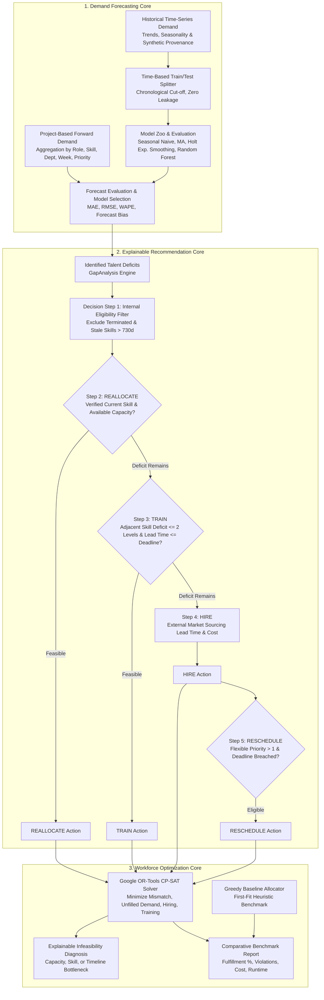

# WorkforceIQ Demand Forecasting & Explainable Recommendation Engine

The **WorkforceIQ Demand Forecasting, Explainable Recommendation, and Optimization Core** enables proactive talent planning, automated skills gap resolution, and mathematical workforce scheduling.

---

## 🏛️ Architecture Overview



---

## 1. Demand Forecasting Framework

WorkforceIQ provides two independent demand sources:

### A. Project-Based Demand Aggregation
Aggregates active, committed, and pipeline project plans chronologically across 5 enterprise dimensions:
1. **Role** (`role_id`): Grouping capacity requirements by job classification.
2. **Skill** (`primary_skill_id`): Tracking volume demand per technology and domain competency.
3. **Department**: Rollups by organizational business unit (Engineering, Platform, Data, Cybersecurity, etc.).
4. **Week** (`start_date` / calendar week e.g. `2026W45`): Time-phased demand sequencing.
5. **Project Priority**: Categorizing requirements into mission-critical (Priority 1) through flexible pipeline tiers (Priority 4).

### B. Historical Demand Time-Series Forecasting
Evaluates historical workforce utilization and demand series to forecast future capacity needs across candidate statistical and machine learning models:

1. **Seasonal Naive Baseline (Benchmark)**:
   $$\hat{y}_{T+h} = y_{T - s + ((h - 1) \pmod s)}$$
   Uses trailing seasonal cycle ($s = 4$ weeks) to project forward cyclical demand.
2. **Moving Average**:
   $$\hat{y}_{T+h} = \frac{1}{k} \sum_{i=0}^{k-1} y_{T-i}$$
   Smoothes high-frequency noise over trailing $k$-period window ($k = 4$).
3. **Double Exponential Smoothing (Holt's Linear Trend)**:
   Level: $l_t = \alpha y_t + (1 - \alpha)(l_{t-1} + b_{t-1})$
   Trend: $b_t = \beta (l_t - l_{t-1}) + (1 - \beta) b_{t-1}$
   Forecast: $\hat{y}_{T+h} = l_T + h \cdot b_T$
4. **Random Forest Autoregressive Regressor**:
   Supervised feature matrix engineered strictly from historical lags ($t-1, t-2, t-3, t-4$), rolling 3-period averages, seasonal period indices, and trend steps.

### Time-Based Splitting & Zero Data Leakage:
- Training and testing datasets are partitioned strictly chronologically (e.g. 80% train, 20% test).
- **Rule**: Never use future information to train a historical forecast. All features for period $t$ are derived exclusively from observations at or before $t-1$.

### Accuracy & Error Metrics:
- **Mean Absolute Error (MAE)**:
  $$\text{MAE} = \frac{1}{n}\sum_{t=1}^n |y_t - \hat{y}_t|$$
- **Root Mean Squared Error (RMSE)**:
  $$\text{RMSE} = \sqrt{\frac{1}{n}\sum_{t=1}^n (y_t - \hat{y}_t)^2}$$
- **Weighted Absolute Percentage Error (WAPE)**:
  $$\text{WAPE} = \frac{\sum_{t=1}^n |y_t - \hat{y}_t|}{\sum_{t=1}^n y_t}$$
- **Forecast Bias**:
  $$\text{Bias} = \frac{\sum_{t=1}^n (\hat{y}_t - y_t)}{\sum_{t=1}^n y_t}$$
  (Positive indicates systematic over-forecasting; negative indicates under-forecasting).

---

## 2. Explainable Recommendation Engine

Resolves talent deficits identified by `GapAnalysis` through an explainable, multi-tiered decision hierarchy.

### Strict Decision Logic:
```
For each identified GapAnalysis / Unfilled Deficit:
  1. Internal Eligibility Filter:
     - Only ACTIVE / PROBATION employees.
     - Exclude terminated employees or those with 0 available capacity.
     - Enforce Stale Skill Invalidation (>730 days discounts certified proficiency to 0).
  2. REALLOCATE (Internal Talent Mobility):
     - Eligible if employee holds verified current skill with proficiency >= required.
     - Uncommitted remaining capacity >= 10h/week.
     - Zero double-counting: commits capacity in accumulator map.
  3. TRAIN (Upskilling / Accelerated Certification):
     - Eligible if employee has adjacent proficiency (proficiency gap <= 2 levels) or stale skill needing recertification.
     - Training duration (14 days/level) <= Days to Project Deadline.
  4. HIRE (External Talent Acquisition):
     - Triggered when internal reallocation and training cannot satisfy demand.
     - Calculates market acquisition lead time (45 days) and recruitment budget ($12,000/head).
  5. RESCHEDULE (Timeline Alignment):
     - Triggered if hiring or training lead time breaches project start date and project priority > 1.
     - Recommends shifting start milestone by 14 to 45 days to eliminate day-one delivery risk.
```

### Generated Recommendation Schema:
Every recommendation includes complete quantitative metrics, narrative explanation, and explicit assumptions:
- `gap_id`: Associated demand plan / deficit identifier.
- `project_id`: Target initiative requiring staffing.
- `required_skill`: Demanded competency.
- `required_hours`: Net hours mitigated.
- `affected_employees`: Identified employee primary keys.
- `expected_cost`: Projected financial investment in USD.
- `estimated_time_to_resolve_days`: Operational duration to operational readiness.
- `expected_shortage_reduction_hours`: Quantitative deficit resolved.
- `deadline_feasibility`: Boolean verification against project start milestone.
- `confidence_score`: 0.000 to 1.000 suitability score.
- `explanation`: Transparent executive reasoning.
- `assumptions`: Documented operational constraints.
- `rule_version`: Governance rule tracking (`"1.0.0"`).

---

## 3. Mathematical Workforce Optimization (Google OR-Tools CP-SAT)

Formulates global multi-project, multi-skill workforce scheduling as an exact Integer Programming problem.

### Mathematical Formulation:

#### Decision Variables:
- $x_{e, d} \in \{0, 1\}$: Direct internal allocation of employee $e$ to demand $d$.
- $t_{e, d} \in \{0, 1\}$: Upskilling and assignment of employee $e$ to demand $d$.
- $h_d \in \{0, 1\}$: External recruitment to cover demand $d$.
- $u_d \in \{0, 1\}$: Unfilled demand penalty.

#### Objective Function:
$$\min \sum_{e, d} C_{\text{mismatch}}(e, d) \cdot x_{e, d} + \sum_d C_{\text{unfilled}} \cdot w_{\text{priority}}(d) \cdot u_d + \sum_d C_{\text{hire}} \cdot h_d + \sum_{e, d} C_{\text{train}} \cdot t_{e, d}$$

#### Constraints:
1. **Demand Satisfaction**:
   $$\sum_{e} x_{e, d} + \sum_{e} t_{e, d} + h_d + u_d = 1 \quad \forall d$$
2. **Employee Capacity Limits**:
   $$\sum_{d} \text{Hours}(d) \cdot (x_{e, d} + t_{e, d}) \le \text{NetCapacity}(e) \quad \forall e$$
3. **Skill Proficiency Feasibility**:
   $$x_{e, d} = 0 \quad \text{if } \text{Proficiency}(e, \text{Skill}(d)) < \text{ReqProf}(d) \lor \text{IsStale}(e, \text{Skill}(d))$$
4. **Training Feasibility**:
   $$t_{e, d} = 0 \quad \text{if } \text{Deficit}(e, d) > 2 \lor \text{TrainingLeadTime}(e, d) > \text{DeadlineToStart}(d)$$
5. **Existing Allocation Preservation**:
   Existing confirmed commitments are subtracted prior to solving, ensuring zero allocation disruption or double-counting.

### Explainable Infeasibility Diagnosis:
If the solver cannot achieve 100% internal allocation under hard constraints, it returns an explainable `InfeasibilityDiagnosis` identifying the exact bottleneck:
- `INSUFFICIENT_QUALIFIED_CAPACITY`: Zero active internal talent holds the required certified skill.
- `CAPACITY_CEILING_REACHED`: All qualified employees are at 100% capacity.
- `DEADLINE_TOO_TIGHT`: Project start date precedes required training or hiring lead times.

### Comparative Baseline Benchmark:
Every optimization run evaluates the solution against a `GreedyBaselineSolver` (first-fit sequential allocator) across:
- Demand fulfillment percentage ($\%$)
- Constraint violations count
- Total operational cost ($\$$)
- Skill mismatch penalty score
- Solve duration (ms)

